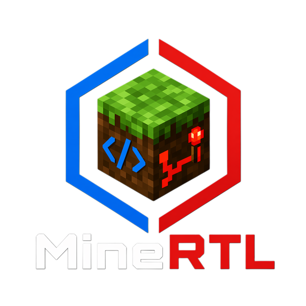

# MineRTL: Verilog to Minecraft Redstone Synthesis

**MineRTL** is a hardware synthesis toolchain that takes standard Verilog HDL code and compiles it into functional 3D Minecraft redstone circuits.

## Features

- **Full Synthesis Pipeline:** Parses, elaborates, and optimizes Verilog using Yosys.
- **Custom Cell Library:** Standard logic gates (AND, OR, XOR, NOT) and D-Flip Flops seamlessly implemented in Minecraft.
- **Automated 3D Routing:** Custom layout engine that handles gate placement and 3D redstone wiring.
- **Litematica Integration:** Outputs `.litematic` files for easy importing into Minecraft worlds or fast simulation via MCHPRS.

## Prerequisites

1. Install [yosys](https://github.com/yosyshq/yosys) (Required for Verilog synthesis)
2. Install [uv](https://github.com/astral-sh/uv) (Fast Python package manager)

## Getting Started

1. **Install Python dependencies:**

```sh
uv sync
```

2. **Generate a schematic:**
   We provide several examples in the `examples/` directory (e.g., `counter`, `full_adder`, `helloworld`). Synthesize the counter example with:

```sh
./synth.sh examples/counter
```

The resulting schematic will be saved to `build/result.litematic`. You can import this directly into a Minecraft world using the Litematica mod.

3. **Synthesis Flags & Configuration:**
   The `synth.sh` script automatically wraps our Python-based layout engine (`main.py`) alongside Yosys. It supports several flags that you can pass directly:
   - `--out-litematic <path>`: Specifies custom output path for the `.litematic` file (Default: `build/result.litematic`).
   - `--out-litematic-dir <dir>`: Writes the `.litematic` to `<dir>/<project-dir name>.litematic` (e.g. `examples/counter` → `<dir>/counter.litematic`). Handled by `synth.sh`.
   - `--artifacts-dir <dir>`: Where the netlist and build artifacts go (Default: `build/artifacts`, or `$MINECRAFT_V_ARTIFACTS_DIR`). Use a separate directory per build to run builds in parallel.
   - `--module <name>`: Sets the top-level Verilog module to synthesize (Default: `main`).
   - `--schematics-dir <dir>`: Sets the directory containing our `.litematic` cell library objects (Default: `schematics`).
   - `--schematic-name <name>`: The name attached to the generated schematic in-game (Default: matches `--module`).
   - `--allow-routing-failures True`: Keeps generating the structure even if some 3D routes fail to connect (useful for debugging physical placement).
   - `--no-debug-prints`: Removes `$write`/`$display`. By default they stay when they're in a clocked block: blocks they read stand on or hang from lime concrete, and `<out>.server.json` is written next to the litematic for MCHPRS `/watch` and `mchprs_headless test --probes`. Off with `--macros`. Non-constant `$sformatf` isn't supported by Yosys: use `$display` directly.
   - `--output-pin-targets-json <file.json>`: Path to a JSON file explicitly dictating output coordinates. Note: `synth.sh` will _automatically_ use `pin_targets.json` if it finds it in your specific project directory.
   - `--generate-clock`: Select the pin to be the clock pin and automatically generate a redstone clock for it. (Default: `clk`)
   - `--server-clock [half period]`: No generated clock, which gets long on large circuits: the clock pin gets a lever, and MCHPRS toggles it every that many redstone ticks, read from `<out>.server.json`. `synth.sh` turns this on when it finds `mchprs_headless` (`$MCHPRS_HEADLESS`, or `target/release` under `$MCHPRS_DIR`, default `~/Projects/MCHPRS`) and no clock flag is given; `--no-server-clock` or `--generate-clock <pin>` keeps the generated clock. (Default half period: from the critical path, the generated clock's period.)

   Example usage:

```sh
./synth.sh examples/counter --module my_counter --out-litematic "counter.litematic" --allow-routing-failures True
```

## Development & Testing

Run our test suite with:

```
uv run pytest
```
